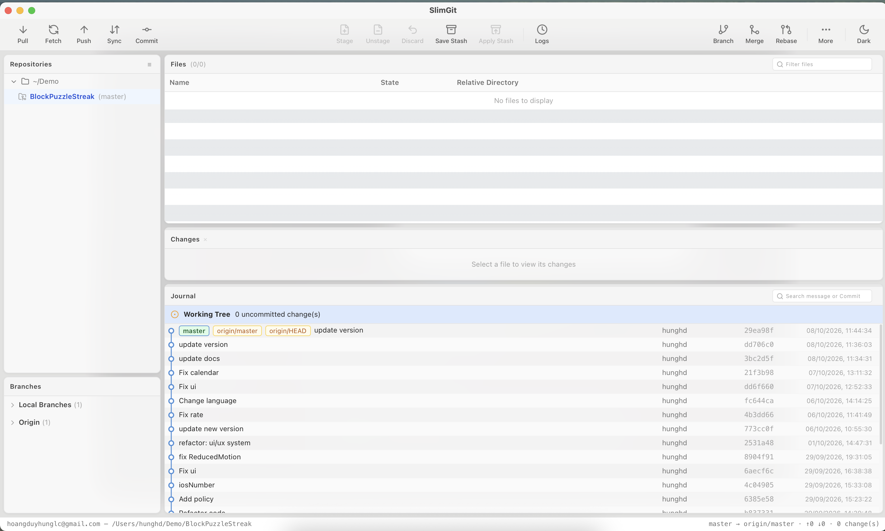

<p align="center">
  
</p>

<p align="center">
  <a href="../README.md">Tiếng Việt</a> |
  <b>English</b>
</p>

<h1 align="center">SlimGit</h1>

<p align="center">
  A slim, SmartGit-style desktop Git client — but simpler.<br>
  Built with Tauri + React
</p>

<p align="center">
  
  
  
  
</p>

<p align="center">
  <a href="#installation">Installation</a> ·
  <a href="#development">Development</a> ·
  <a href="#tech-stack">Tech Stack</a>
</p>

---

<p align="center">
  
</p>

---

## Installation

Download the latest release for your platform from the [Releases](../../releases) page.

| Platform | Format      |
|----------|-------------|
| macOS    | `.dmg`      |
| Windows  | `.msi`      |
| Linux    | `.AppImage` |

---

## Development

**Prerequisites:** [Rust](https://rustup.rs/) · [Node.js](https://nodejs.org/) 18+ · [Git](https://git-scm.com/)

```bash
npm install
npm run tauri dev     # desktop app with hot-reload
```

**UI preview in browser (no Rust build needed):**

```bash
npm run dev           # http://localhost:1420
```

`src/mock.ts` serves realistic sample data when running outside Tauri — handy for iterating on the UI without a native build.

**Production build:**

```bash
npm run tauri build   # bundle in src-tauri/target/release/bundle
```

---

## Tech Stack

- **Frontend:** React · TypeScript · Vite
- **Backend:** Rust (Tauri)
- **Git:** native `git` CLI

---

## License

MIT — see [LICENSE](../LICENSE).